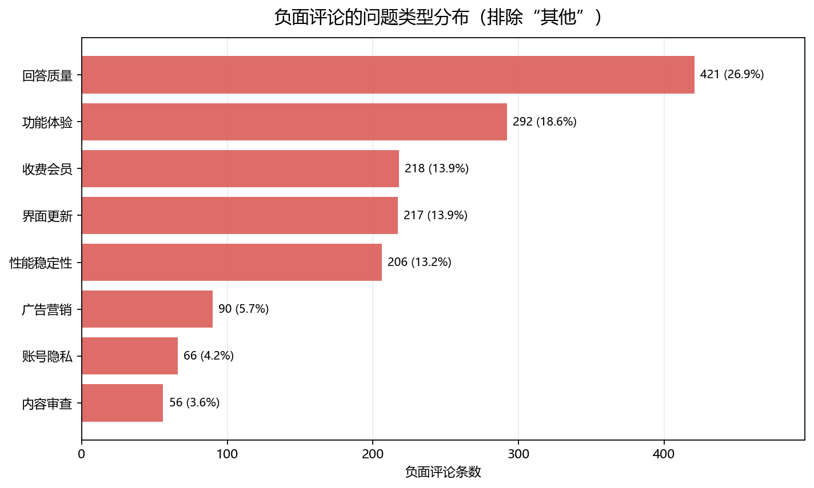
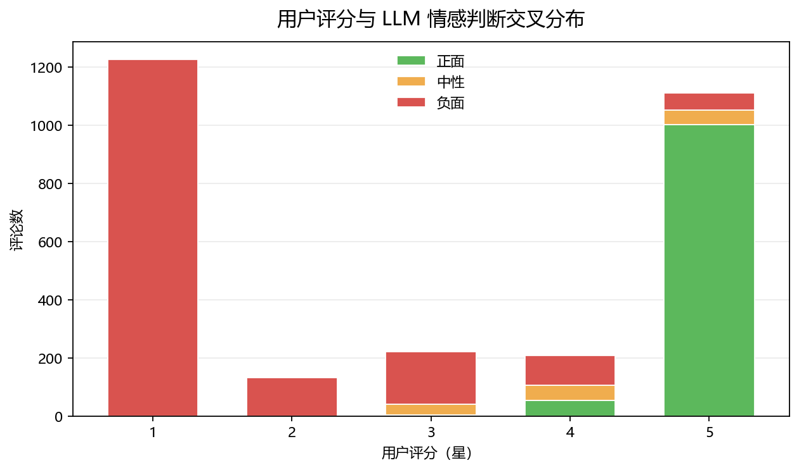

# AI 产品评论分析报告

> 数据源：Apple App Store 中国区用户评论（公开 RSS 接口）  
> 样本：7 款 AI 助手，3497 条原始评论，2902 条有效文本  
> 分析时间：2026 年 10 月  
> 打标模型：DeepSeek `deepseek-chat`（标签版本 `deepseek-chat-v1`）

---

## 摘要

- 抓取了豆包、DeepSeek、文心一言、Kimi、通义千问、腾讯元宝、智谱清言 7 款 AI 助手的 3497 条 App Store 评论，其中 2902 条为不少于 5 字的有效文本。
- 用 DeepSeek 对 2902 条文本做结构化打标：情感、问题类别、严重度、是否可行动、原文关键句。最终 **2902/2902 全部打标成功**。
- 整体情感：**负面 58.6%、正面 36.6%、中性 4.8%**。这个比例受“最近评论”采集方式影响，不代表产品全生命周期口碑。
- **回答质量是全行业共性痛点**：在可归类的负面评论中占 26.9%，是 7 个产品中排名前三的问题。
- 产品差异明显：
  - **文心一言**：负面率最高（79.1%），主要矛盾是改版后的界面与交互（102 条）。
  - **Kimi**：收费/会员问题压倒性突出（153 条），接近其负面评论的一半。
  - **DeepSeek**：回答质量（100 条）和功能体验（99 条）双高。
  - **腾讯元宝**：回答质量之外，广告营销（46 条）是最有辨识度的问题。
  - **豆包 / 通义千问**：负面率明显更低，但样本仅覆盖 2~6 天，需谨慎外推。
- 重要限制：每个产品最多 500 条、各产品时间窗不同、LLM 标签不是人工金标准。详见第 7 节。

---

## 1. 背景与目标

AI 助手产品功能同质化严重，用户评论是低成本、高密度的真实反馈来源，但以非结构化文本为主，难以直接量化。

本项目目标：

1. 对比 7 款主流 AI 助手在 App Store 中国区的用户情感与问题结构。
2. 回答“用户到底在不满什么”，而不是只看星级。
3. 给出可落地的产品改进优先级。
4. 沉淀一套可复用的“采集 → 数仓 → LLM 打标 → 分析”流程。

---

## 2. 数据

### 2.1 来源与样本

数据来自 Apple 公开的 App Store 评论 RSS 接口，按“最新评论”排序，每个 App 最多抓取 10 页 × 50 条。

| 产品 | 原始评论 | 有效文本 | 全量平均分 | 时间范围 |
|---|---:|---:|---:|---|
| DeepSeek | 500 | 470 | 2.64 | 2026-09-26 ~ 2026-10-11 |
| Kimi | 500 | 453 | 2.58 | 2026-07-07 ~ 2026-10-10 |
| 智谱清言 | 500 | 448 | 2.33 | 2024-11-13 ~ 2026-10-10 |
| 文心一言 | 500 | 435 | 2.31 | 2025-03-19 ~ 2026-10-09 |
| 腾讯元宝 | 500 | 393 | 2.90 | 2026-08-31 ~ 2026-10-10 |
| 豆包 | 497 | 363 | 4.30 | 2026-10-09 ~ 2026-10-11 |
| 通义千问 | 500 | 340 | 4.56 | 2026-10-05 ~ 2026-10-10 |

字段：产品、评分、版本、评论时间、标题、正文、用户名、点赞数。

### 2.2 清洗与短评偏差

清洗规则：

- 过滤正文少于 5 字的短评（如“好”“垃圾”）。
- 时间从美西时间转换为中国时间（+08:00）。
- 去重：产品 + 时间 + 正文。

原始 3497 条 → 有效文本 2902 条，过滤 595 条短评。

这里有一个容易被忽略的偏差：

| 样本 | 条数 | 平均评分 |
|---|---:|---:|
| 全部评论 | 3497 | 3.09 |
| 有效文本 | 2902 | 2.95 |
| 被过滤的短评 | 595 | 3.77 |

**高分用户更倾向写短评**。如果直接用清洗后的数据算平均分，会低估产品口碑。

处理方式：

- 事实表保留全部 3497 条，用 `is_short_content` 标记短评。
- **评分类指标用全量**；**文本类分析才过滤短评**。
- 本报告的 LLM 情感/问题分析基于 2902 条有效文本。

数据质量检查：无空时间、无非法评分、无空正文、无重复。

### 2.3 时间窗不一致

RSS 按“最新评论”返回，各产品的数据覆盖时间差异很大：

- 豆包只有 2 天，通义只有 6 天；
- 文心/智谱覆盖近两年；
- 其余产品覆盖数周至数月。

若统一到 2026-09-26 ~ 2026-10-11：

| 产品 | 窗口内评论数 |
|---|---:|
| DeepSeek | 500 |
| 通义千问 | 500 |
| 豆包 | 497 |
| 腾讯元宝 | 190 |
| Kimi | 55 |
| 文心一言 | 8 |
| 智谱清言 | 8 |

**只有前 5 个产品具备方向性比较价值**；文心/智谱在该窗口样本过少。因此本报告的跨产品对比只作为方向性结论，不作因果判断。

---

## 3. 数仓设计

采用 ODS → DWD → DIM/FACT → DWS → ADS 分层：

```text
ODS   reviews_raw                 原始字符串数据
        │
        ▼  清洗 / 时区 / 去重 / 质量标记
DWD   dwd_review_detail           粒度：一条评论
        │
        ├──────────► dim_app      产品维
        ├──────────► dim_date     日期维
        ▼
FACT  fact_review                 粒度：一条评论
        │
        ▼
DWS   dws_app_daily               粒度：App-天
        │
        ▼
ADS   ads_app_summary             产品总览
      ads_app_rating_dist         评分分布
```

关键设计：

- 事实表粒度为“一条评论”，保留评分、点赞数、正文长度等度量。
- 短评不删除，用 `is_short_content` 标记，避免评分指标被清洗规则扭曲。
- 日期维预生成 698 天，支持按年/季/月/周/周末分析。
- 不建外键，用索引保证关联性能，符合数仓常见做法。
- 标签结果单独放在 `review_labels`，粒度为“评论 × 标签版本”，方便换模型/换 prompt 后对比。

主要文件：

| 文件 | 作用 |
|---|---|
| `warehouse.sql` | 重建数仓和 ETL |
| `queries.sql` | 9 条基础分析 SQL |
| `label_tables.sql` | 打标结果表 + 宽表视图 |
| `label_reviews.py` | DeepSeek 批量打标 |
| `label_ads.sql` | 情感/问题/总览视图 |
| `label_queries.sql` | 8 条打标后分析 SQL |
| `export_qa.py` | 导出人工抽检表 |
| `make_charts.py` | 生成报告图表 |

---

## 4. LLM 打标方法

### 4.1 为什么用 LLM

关键词规则能统计“广告”“会员”等词，但无法稳定区分：

- “没有广告，很干净” vs “广告太多了”；
- “会员权益不错” vs “充了会员还要预约”；
- 一条评论同时提到多个问题。

LLM 可以结合上下文输出结构化标签，把 2902 条非结构化文本变成可 `GROUP BY` 的字段。

### 4.2 标签体系

每条评论输出：

```json
{
  "sentiment": "negative",
  "issue_category": "收费会员",
  "severity": 2,
  "is_actionable": true,
  "key_quote": "充了会员还要预约",
  "confidence": 0.9
}
```

问题类别定义：

| 类别 | 定义 |
|---|---|
| 回答质量 | 答案错误、幻觉、逻辑差、不准确、答非所问、生成质量差 |
| 功能体验 | 功能缺失、操作不便、功能不好用 |
| 性能稳定性 | 闪退、卡顿、加载慢、崩溃、网络问题 |
| 收费会员 | 价格、订阅、会员权益、额度、退款 |
| 广告营销 | 广告多、推广、营销骚扰 |
| 账号隐私 | 登录、注册、封号、数据隐私、自动登录 |
| 内容审查 | 敏感词、限制发言、内容被屏蔽 |
| 界面更新 | UI、改版、更新后体验变化 |
| 其他 | 无法归入以上类别 |

严重度：1 = 轻微抱怨，2 = 影响使用，3 = 严重问题/要求退款/卸载。  
`is_actionable`：是否包含具体可改进的信息，用于区分“纯情绪发泄”和“有效反馈”。

### 4.3 工程实现

- 模型：`deepseek-chat`，温度 0，JSON 输出模式。
- 单条评论一次请求，6 并发；失败重试 3 次。
- 每 20 条提交一次数据库，支持断点续跑。
- 以 `review_id + label_version` 为主键，重复运行不会重复插入。
- 保存模型原始返回，便于排查。

全量运行结果：

- 成功 **2902/2902**，最终失败 0。
- 中途出现一次代理 502，282 条通义千问失败；绕过代理重跑后全部成功。
- 总消耗约 **138 万 token**，成本约几块钱。

### 4.4 质量评估

| 指标 | 数值 |
|---|---:|
| 平均置信度 | 0.88 |
| 评分与情感冲突 | 163 条（5.6%） |
| 低置信度（<0.7） | 70 条（2.4%） |

冲突样本大多不是模型错误，而是真实矛盾：例如用户给 5 星，但正文在吐槽某个功能；或 4 星评论同时包含明显不满。

已导出人工抽检表：

- `qa_sample_30.csv`：按情感分层 30 条（负面 12 / 正面 12 / 中性 6）。
- `qa_hard_cases_20.csv`：20 条低置信度/评分冲突样本。

> 人工抽检准确率待补充。本报告中的情感和问题结论应视为“模型判断”，不是人工金标准。

---

## 5. 分析结果

### 5.1 整体情感

| 情感 | 条数 | 占比 |
|---|---:|---:|
| 负面 | 1701 | 58.6% |
| 正面 | 1062 | 36.6% |
| 中性 | 139 | 4.8% |


注意：这是“最近评论”样本，不是产品历史全量评论；负面占比高，部分原因是 App Store 用户更倾向在遇到问题时写评论。

### 5.2 负面评论的问题结构

排除“其他”后，1566 条可归类负面评论的分布：

| 问题类别 | 条数 | 占比 | 平均严重度 | 可行动率 |
|---|---:|---:|---:|---:|
| 回答质量 | 421 | 26.9% | 2.37 | 87.4% |
| 功能体验 | 292 | 18.7% | 2.18 | 97.3% |
| 收费会员 | 218 | 13.9% | 2.52 | 92.7% |
| 界面更新 | 217 | 13.9% | 1.97 | 92.6% |
| 性能稳定性 | 206 | 13.2% | 2.47 | 98.1% |
| 广告营销 | 90 | 5.8% | 2.41 | 94.4% |
| 账号隐私 | 66 | 4.2% | 2.79 | 97.0% |
| 内容审查 | 56 | 3.6% | 2.36 | 96.4% |

另有 135 条负面评论归为“其他”（占全部负面评论的 7.9%），多为纯情绪表达或信息不足。



三个值得注意的点：

1. **回答质量是共性第一问题**：26.9% 的可归类负面评论指向答案错误、幻觉、逻辑差、答非所问。
2. **收费/会员虽然只排第三，但严重度很高**（2.52），说明一旦用户不满，往往涉及“钱”和“权益”，情绪更强。
3. **账号隐私平均严重度最高**（2.79），虽然只有 66 条，但多为登录、封号、隐私风险等高风险问题，值得单独监控。

### 5.3 产品对比

| 产品 | 有效文本 | 负面率 | 平均严重度 | 可行动率 | Top 3 负面问题（条数） |
|---|---:|---:|---:|---:|---|
| 文心一言 | 435 | 79.1% | 2.00 | 78.4% | 界面更新 102 / 回答质量 77 / 功能体验 58 |
| 智谱清言 | 448 | 75.5% | 2.14 | 71.2% | 性能稳定性 70 / 回答质量 65 / 功能体验 58 |
| DeepSeek | 470 | 74.3% | 1.94 | 79.8% | 回答质量 100 / 功能体验 99 / 界面更新 50 |
| Kimi | 453 | 68.7% | 2.02 | 73.5% | 收费会员 153 / 性能稳定性 52 / 回答质量 42 |
| 腾讯元宝 | 393 | 58.5% | 1.79 | 57.8% | 回答质量 79 / 广告营销 46 / 界面更新 37 |
| 豆包 | 363 | 21.2% | 1.26 | 24.0% | 回答质量 43 / 功能体验 12 / 界面更新 5 |
| 通义千问 | 340 | 15.3% | 1.20 | 22.1% | 回答质量 15 / 功能体验 7 / 广告营销 5 |


### 5.4 各产品诊断

#### 文心一言：改版是最大矛盾

- 负面率 79.1%，全样本最高。
- 界面更新 102 条，远超其他问题；典型反馈是“更新后界面变复杂”“找不到原来的功能”。
- 回答质量 77 条，功能体验 58 条。
- 推测改版对老用户的操作习惯造成了明显冲击，但本项目不能证明因果关系。

建议：评估是否提供“简洁模式/旧版布局”；把改版说明和功能入口做在显眼位置；对高频流失路径做可用性测试。

#### 智谱清言：性能与稳定性优先

- 负面率 75.5%，平均严重度 2.14。
- 性能稳定性 70 条，是 Top 1；回答质量 65 条，功能体验 58 条。
- 用户反馈集中在卡顿、响应慢、上下文处理不好等影响连续使用的问题。

建议：优先做稳定性与响应速度的回归测试；对长上下文、连续对话场景做专项优化；把“可用性”而不是“新功能”作为短期目标。

#### DeepSeek：回答质量与功能体验双高

- 负面率 74.3%，可行动率 79.8%，说明用户吐槽具体、可改进空间大。
- 回答质量 100 条、功能体验 99 条、界面更新 50 条，三者合计约占其负面评论的七成。
- 典型问题包括答案质量下滑、功能限制、更新后体验变化。

建议：建立回答质量的回归评测集；对高频功能限制给出更清晰的提示；更新前做小范围灰度，避免一次性改变用户习惯。

#### Kimi：收费/会员是压倒性问题

- 负面率 68.7%，收费会员 153 条，接近其负面评论的一半。
- 性能稳定性 52 条、回答质量 42 条。
- 会员相关反馈可能涉及价格、额度、预约、权益兑现等，严重度 2.52，高于整体平均。

建议：把会员权益、额度规则、预约机制讲清楚；对“付了钱但体验不达预期”的场景做专项补偿或退款流程；监控会员用户的留存与投诉。

#### 腾讯元宝：回答质量之外，广告最显眼

- 负面率 58.5%，回答质量 79 条、广告营销 46 条、界面更新 37 条。
- 广告问题约占其负面评论的 20%，是 7 个产品里最突出的。
- 关键词扫描中“广告”提及率 10.18%，与 LLM 分类结果一致。

建议：控制广告出现的频率和位置，避免在核心问答路径中插入推广；把广告与会员权益的关系说清楚；同时继续提升回答质量。

#### 豆包：整体口碑较好，回答质量仍是主要问题

- 负面率 21.2%，平均严重度 1.26，均处于低位（仅次于样本更短的通义千问）。
- 回答质量 43 条、功能体验 12 条、界面更新 5 条。
- 但样本仅覆盖 2026-10-09 ~ 10-11 两天，不能代表长期口碑。

建议：保持现有体验；把回答准确性作为下一阶段的重点；扩大数据窗口后再判断是否存在被短期好评掩盖的问题。

#### 通义千问：样本最短，结论谨慎

- 负面率 15.3%，样本仅 6 天。
- 回答质量 15 条、功能体验 7 条、广告营销 5 条。
- 数据量不足以支撑稳定的产品诊断。

建议：延长采集窗口或增加数据源后再评估；当前更适合作为“正面参照”，而不是结论对象。

### 5.5 评分与情感的关系



| 评分 | 正面 | 中性 | 负面 | 负面占比 |
|---:|---:|---:|---:|---:|
| 1 星 | 0 | 1 | 1224 | 99.9% |
| 2 星 | 0 | 0 | 134 | 100.0% |
| 3 星 | 4 | 38 | 180 | 81.1% |
| 4 星 | 55 | 52 | 103 | 49.0% |
| 5 星 | 1003 | 48 | 60 | 5.4% |

两个观察：

- 1~2 星几乎全是负面，5 星以正面为主，说明评分和文本情感整体一致。
- **4 星评论中仍有 49% 被判为负面**：很多用户“给了面子但正文在吐槽”。只看星级会漏掉这部分反馈。
- 5 星评论中也有 60 条负面，主要是“表扬整体、批评细节”或误触评分。

---

## 6. 建议优先级

| 优先级 | 问题 | 依据 | 建议 |
|---|---|---|---|
| P0 | 回答质量 | 26.9% 的负面评论，7 个产品均进入前三 | 建立回归评测集；针对幻觉、答非所问、生成质量做专项优化 |
| P0 | 收费/会员体验 | Kimi 153 条；平均严重度 2.52 | 明确权益/额度/预约/退款规则；对付费用户做专项体验保障 |
| P1 | 改版与界面 | 文心 102 条、DeepSeek 50 条 | 灰度发布；提供旧版/简洁模式；加强改版引导 |
| P1 | 性能稳定性 | 智谱 70 条、Kimi 52 条；严重度 2.47 | 稳定性回归、长上下文专项、崩溃/卡顿监控 |
| P1 | 广告干扰 | 元宝 46 条，提及率 10.18% | 控制广告频次与位置，避免核心问答路径插入 |
| P2 | 账号与隐私 | 66 条，但平均严重度最高 2.79 | 登录/封号/隐私风险单独监控，建立快速响应机制 |
| P2 | 内容审查 | 56 条 | 提高规则透明度，减少误伤，提供申诉入口 |

---

## 7. 局限

1. **不是全量评论**：每个 App 最多 500 条，且按最新评论排序。
2. **时间窗不一致**：豆包/通义只有几天数据，文心/智谱覆盖近两年；跨产品对比只能看方向。
3. **短评过滤偏差**：有效文本样本偏向长评论，评分指标已改用全量数据校正，但文本结论仍不代表所有用户。
4. **LLM 标签不是人工金标准**：平均置信度 0.88，仍有 163 条评分-情感冲突、70 条低置信度样本；人工抽检准确率待补充。
5. **不能做因果推断**：例如“文心改版导致负面率最高”只是样本中的相关现象，不能证明因果。
6. **平台局限**：仅 App Store 中国区，未覆盖安卓、社交媒体、客服工单等渠道。

---

## 8. 项目产出与复现

### 8.1 数据与代码

| 文件/对象 | 说明 |
|---|---|
| `fetch_reviews.py` | 抓取 App Store 评论 |
| `import_to_mysql.py` | CSV 导入 MySQL |
| `clean.sql` | 基础清洗 |
| `warehouse.sql` | 分层数仓 + ETL |
| `queries.sql` | 基础分析 SQL |
| `label_tables.sql` | 打标结果表 |
| `label_reviews.py` | DeepSeek 批量打标 |
| `label_ads.sql` | 打标汇总视图 |
| `label_queries.sql` | 打标分析 SQL |
| `export_qa.py` | 导出人工抽检表 |
| `make_charts.py` | 生成报告图表 |
| `review_labels` | 2902 条打标结果 |
| `fact_review` | 3497 条评论事实 |
| `ads_app_summary` | 产品总览 |
| `ads_app_sentiment` / `ads_app_issue` | 情感/问题分布视图 |

### 8.2 复现命令

```bash
cd "D:/实习准备/AI产品评论分析"

# 1. 重建数仓
mysql -uroot --default-character-set=utf8mb4 < warehouse.sql

# 2. 建打标表
mysql -uroot --default-character-set=utf8mb4 < label_tables.sql

# 3. 打标（需要 .env 中的 DEEPSEEK_API_KEY）
python label_reviews.py --workers 6

# 4. 生成图表
python make_charts.py
```

### 8.3 简历写法（可直接改）

> **AI 产品评论分析｜独立项目**  
> - 抓取 7 款 AI 助手 3497 条 App Store 评论，搭建 MySQL 分层数仓（ODS→DWD→DIM/FACT→DWS→ADS），沉淀 10+ 张表/视图。
> - 设计短评偏差校正方案：评分指标保留全量 3497 条，文本分析使用 2902 条，避免过滤短评造成的 3.77 vs 2.95 偏差。
> - 使用 DeepSeek 对 2902 条评论做情感与问题分类，设计 9 类问题标签与严重度体系，完成 2902/2902 打标，平均置信度 0.88。
> - 输出产品诊断：回答质量是全行业第一痛点（26.9%）；Kimi 收费/会员问题 153 条；文心一言界面改版问题 102 条。

### 8.4 面试可讲点

- 为什么数仓要分层？ODS/DWD/DWS/ADS 各自解决什么问题？
- 事实表粒度为什么定成“一条评论”？短评为什么保留？
- 如何发现并处理短评过滤带来的选择偏差？
- 各产品时间窗不一致时，如何避免错误对比？
- LLM 打标如何保证一致性？`label_version`、温度 0、JSON 输出、置信度、抽检分别起什么作用？
- 163 条评分-情感冲突说明了什么？为什么不能只看星级？

---

## 9. 后续计划

1. 完成 30 条人工抽检，计算整体/分类准确率，补进本报告。
2. 做 Dashboard：情感分布、问题 Top 榜、产品对比、趋势。
3. 扩大时间窗或接入安卓/社媒数据，降低采样偏差。
4. 可选：基于评论数据做一个 RAG 问答应用（“用户对 Kimi 收费的主要抱怨是什么？”），把数据分析和 LLM 应用串起来。

---

## 附录：标签分布

| 问题类别 | 全部标签数（含正面/中性） |
|---|---:|
| 其他 | 952 |
| 回答质量 | 557 |
| 功能体验 | 434 |
| 收费会员 | 258 |
| 界面更新 | 247 |
| 性能稳定性 | 226 |
| 广告营销 | 94 |
| 账号隐私 | 70 |
| 内容审查 | 64 |

> 注：全部标签中的“其他”包含大量正面评论；问题结构分析应使用“负面评论 + 排除其他”的口径（n=1566）。
