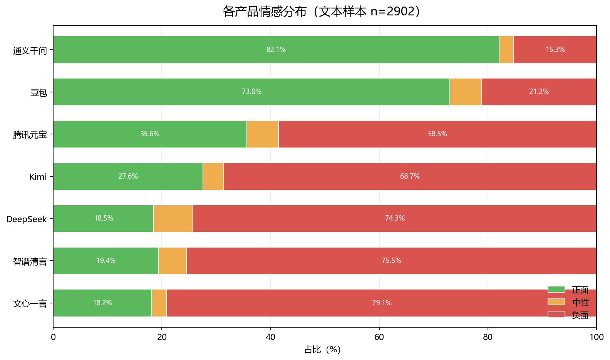
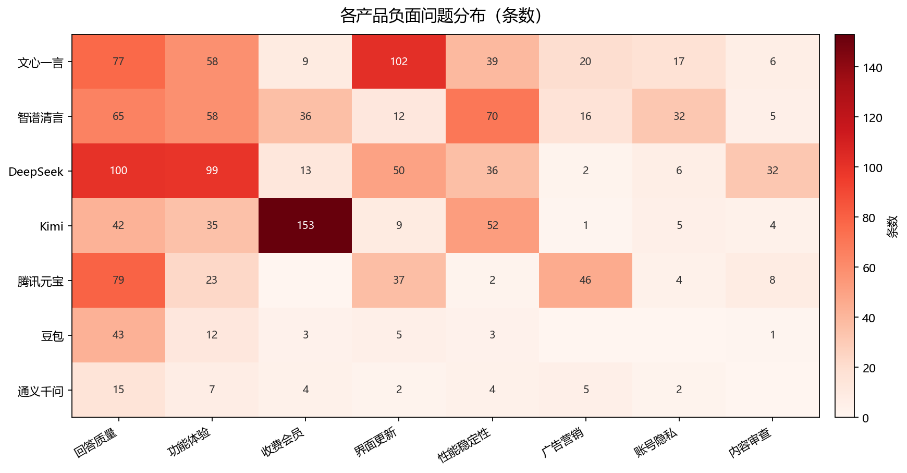

# AI 产品评论分析

抓取 7 款主流 AI 助手的 App Store 中国区评论，搭建 MySQL 分层数仓，并用 DeepSeek 对 2902 条用户评论做情感与问题分类，输出产品诊断报告。

## 核心结论

- 样本：7 款产品、3497 条原始评论、2902 条有效文本。
- 整体情感：负面 58.6%、正面 36.6%、中性 4.8%。
- **回答质量是全行业共性痛点**：占可归类负面评论的 26.9%。
- 产品差异：文心一言主要是改版/界面问题，Kimi 主要是收费/会员问题，DeepSeek 是回答质量 + 功能体验，腾讯元宝广告问题突出，豆包/通义千问口碑较好但样本窗口较短。





## 分析报告

完整的方法、数据局限、产品诊断和简历写法见：

**[AI产品评论分析报告.md](AI产品评论分析报告.md)**

## 项目结构

```text
.
├── fetch_reviews.py          # 抓取 App Store 评论
├── import_to_mysql.py        # CSV 导入 MySQL
├── clean.sql                 # 基础清洗
├── warehouse.sql             # 分层数仓 + ETL
├── queries.sql               # 基础分析 SQL
├── label_tables.sql          # LLM 打标结果表
├── label_reviews.py          # DeepSeek 批量打标
├── label_ads.sql             # 情感/问题汇总视图
├── label_queries.sql         # 打标后分析 SQL
├── export_qa.py              # 导出人工抽检表
├── make_charts.py            # 生成报告图表
├── AI产品评论分析报告.md      # 完整分析报告
├── charts/                   # 报告图表
├── qa_sample_30.csv          # 分层人工抽检样本
├── qa_hard_cases_20.csv      # 低置信度/冲突样本
└── ai_app_reviews.csv        # 原始评论数据
```

## 快速开始

### 1. 准备 MySQL

默认连接：`localhost:3306`，用户 `root`，空密码，数据库 `ai_reviews`。

```bash
cd "D:/实习准备/AI产品评论分析"

mysql -uroot --default-character-set=utf8mb4 < warehouse.sql
mysql -uroot --default-character-set=utf8mb4 < label_tables.sql
mysql -uroot --default-character-set=utf8mb4 < label_ads.sql
```

### 2. 安装依赖

```bash
pip install -r requirements.txt
```

### 3. 配置 DeepSeek API Key

```bash
cp .env.example .env
```

在 `.env` 中填入：

```
DEEPSEEK_API_KEY=sk-xxxxxxxx
```

`.env` 已被 `.gitignore` 忽略，不会提交到仓库。

### 4. 打标并生成图表

```bash
python label_reviews.py --limit 30     # 小批量测试
python label_reviews.py --workers 6    # 全量，已打过的自动跳过
python make_charts.py
```

> 如果遇到代理 502：
> `NO_PROXY=api.deepseek.com python label_reviews.py --workers 3`

## 数据说明

- 数据源：Apple App Store 中国区公开评论 RSS。
- 每个 App 最多 500 条，按最新评论排序。
- 各产品时间窗不同，跨产品对比只作为方向性结论。
- LLM 标签不是人工金标准；抽检文件已生成，准确率待人工标注后补充。

## 技术栈

Python、MySQL、SQL、pandas、DeepSeek API、Matplotlib。

## 声明

本项目仅用于学习与作品集展示，评论内容来自公开 App Store 接口，不代表产品真实全量口碑。
